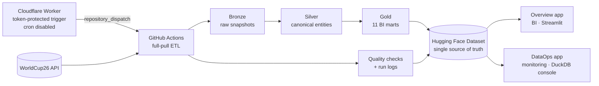

# WorldCup Pulse

A free-tier, cloud-automated data platform for the FIFA World Cup 2026. A GitHub Actions ETL pulls the WorldCup26 API, builds a Bronze/Silver/Gold Parquet lakehouse, and publishes it to a Hugging Face Dataset as decoupled storage. Two stateless Streamlit apps read from that dataset: a public BI app and a DataOps monitor.

> **Status:** the tournament ended in July 2026. The scheduled refresh is disabled in both the GitHub workflow and the Cloudflare Worker (`crons = []`). You can still run the ETL from the Actions tab or through the token-protected Worker endpoint.

## Architecture



## Engineering highlights

- **Fully serverless, $0 to run**: Cloudflare Worker trigger, GitHub Actions compute, Hugging Face storage and hosting.
- **Simple full refresh**: every run pulls each API endpoint in full and rebuilds all layers. There is no incremental watermark; `state/last_run.json` only records the last successful run.
- **No invented numbers**: every stat comes from the API payload or is computed from it (scores, goal tallies, standings). Stats the API does not provide are published as null and shown as "N/A" or "Not available". This covers xG, shots, possession, pass accuracy, cards, set-piece goals, attendance, assists, and shot locations. Lineups, substitutions, goalkeeper stats, and player ratings are not published.
- **Fail loudly on source errors**: if the API is unreachable, the run fails with a non-zero exit. It does not swap in sample data. Mock data needs an explicit `--use-mock` flag and is never uploaded.
- **Decoupled storage** — the code repo never commits data; the HF Dataset repo is the only place lakehouse files live.
- **Medallion layers** in Parquet, read by DuckDB in the apps for fast, serverless queries.
- **Data quality and auditability** — per-run checks by layer/table and a pipeline run log, surfaced in the DataOps app.
- **Stateless UIs** with a 5-minute cache. If the dataset cannot be read, the apps fall back to built-in sample data and show a prominent **MOCK DATA** banner.

## Repository layout

```text
lakehouse/
  pipelines/          ingest → bronze → silver → gold → quality checks → upload_to_hf
  cloud/              Cloudflare Worker that dispatches the ETL workflow (bearer-token protected, cron disabled)
  requirements.txt
apps/
  overview/           Public BI app: overview, match center, standings, teams, players, venues
  dataops/            Pipeline heartbeat, quality-check tabs, DuckDB console over gold marts
docs/
  lakehouse-deployment.md   End-to-end deployment checklist and secrets
  hf-dataset-card.md        Dataset card: lakehouse layout and every gold mart
.github/workflows/etl.yml   ETL job (dispatch / manual)
```

## Run locally

```bash
python -m venv .venv && source .venv/bin/activate   # Windows: .venv\Scripts\activate
pip install -r lakehouse/requirements.txt
cd lakehouse && python pipelines/run_pipeline.py --source worldcup26
```

Without `HF_TOKEN` and `HF_DATASET_REPO` the pipeline writes to `lakehouse/data/` only. If the WorldCup26 API is unavailable, the run exits non-zero. For an offline demo with the bundled sample payload, opt in explicitly:

```bash
cd lakehouse && python pipelines/run_pipeline.py --source worldcup26 --use-mock   # or WORLDCUP_USE_MOCK=1
```

The run manifest records mock runs (`used_mock: true`), and the upload step refuses to publish them to Hugging Face. `--mode` is accepted for compatibility and is only recorded; every run is a full pull.

To run an app:

```bash
pip install -r apps/overview/requirements.txt
streamlit run apps/overview/app.py
```

## Deploy

See [docs/lakehouse-deployment.md](docs/lakehouse-deployment.md) for the full checklist: HF Dataset repo, GitHub secrets (`HF_TOKEN`, `HF_DATASET_REPO`), the two Spaces (`apps/overview`, `apps/dataops`), and the Cloudflare Worker secrets.

The Worker only dispatches the ETL for a `POST` request that carries a shared secret. Without the secret it returns `401`, and it returns `503` if the secret is not configured:

```bash
cd lakehouse/cloud/cloudflare-worker
wrangler secret put GITHUB_TOKEN     # token allowed to call repository_dispatch
wrangler secret put GITHUB_REPO      # owner/repo
wrangler secret put TRIGGER_TOKEN    # shared secret for HTTP triggers
wrangler deploy                      # crons = [] also removes any previously deployed cron

curl -X POST -H "Authorization: Bearer $TRIGGER_TOKEN" https://<your-worker>.workers.dev/
```

## Gold marts

Tournament KPIs, goals by matchday and minute bucket, host cities, team radar and key metrics, goal-scorer leaderboard, team table, matches, group standings, and match events. [docs/hf-dataset-card.md](docs/hf-dataset-card.md) has column-level descriptions and lists which columns are null when the source does not provide them.

## Tech stack

Python · pandas · PyArrow · DuckDB · Streamlit · Plotly · GitHub Actions · Cloudflare Workers · Hugging Face Hub

## License

[MIT](LICENSE)
