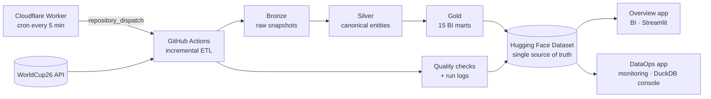

# WorldCup Pulse

A free-tier, cloud-automated, near-real-time data platform for the FIFA World Cup 2026. A serverless cron triggers an incremental ETL that builds a Bronze/Silver/Gold Parquet lakehouse, publishes it to a Hugging Face Dataset as decoupled storage, and serves it to two stateless Streamlit apps: a public BI app and a DataOps monitor.

> **Status:** the tournament has ended (July 2026). The scheduled refresh is disabled; the ETL can still be run on demand from the Actions tab.

## Architecture



## Engineering highlights

- **Fully serverless, $0 to run** — Cloudflare Workers cron, GitHub Actions compute, Hugging Face storage and hosting.
- **Incremental processing** with watermark state (`state/last_run.json`) instead of full reloads.
- **Decoupled storage** — the code repo never commits data; the HF Dataset repo is the only place lakehouse files live.
- **Medallion layers** in Parquet, read by DuckDB in the apps for fast, serverless queries.
- **Data quality and auditability** — per-run checks by layer/table and a pipeline run log, surfaced in the DataOps app.
- **Stateless UIs** with a 5-minute cache and mock fallback data, so apps demo before the first ETL lands.

## Repository layout

```text
lakehouse/
  pipelines/          ingest → bronze → silver → gold → quality checks → upload_to_hf
  cloud/              Cloudflare Worker that dispatches the ETL workflow
  requirements.txt
apps/
  overview/           Public BI app: overview, match center, standings, teams, players, venues
  dataops/            Pipeline heartbeat, quality-check tabs, DuckDB console over gold marts
docs/
  lakehouse-deployment.md   End-to-end deployment checklist and secrets
  hf-dataset-card.md        Dataset card: lakehouse layout and every gold mart
.github/workflows/etl.yml   ETL job (dispatch / manual)
```

## Run locally

```bash
python -m venv .venv && source .venv/bin/activate   # Windows: .venv\Scripts\activate
pip install -r lakehouse/requirements.txt
cd lakehouse && python pipelines/run_pipeline.py --source worldcup26 --mode incremental
```

Without `HF_TOKEN` and `HF_DATASET_REPO` the pipeline writes to `lakehouse/data/` only. To run an app:

```bash
pip install -r apps/overview/requirements.txt
streamlit run apps/overview/app.py
```

## Deploy

See [docs/lakehouse-deployment.md](docs/lakehouse-deployment.md) for the full checklist: HF Dataset repo, GitHub secrets (`HF_TOKEN`, `HF_DATASET_REPO`), the two Spaces (`apps/overview`, `apps/dataops`), and the Cloudflare Worker secrets (`GITHUB_TOKEN`, `GITHUB_REPO`).

## Gold marts

Tournament KPIs, goals by matchday and minute bucket, host cities, team radar and key metrics, player leaderboard, team table, matches, group standings, match events, substitutions, lineups, goalkeepers, and per-match player stats. Column-level descriptions are in [docs/hf-dataset-card.md](docs/hf-dataset-card.md).

## Tech stack

Python · pandas · PyArrow · DuckDB · Streamlit · Plotly · GitHub Actions · Cloudflare Workers · Hugging Face Hub

## License

[MIT](LICENSE)
